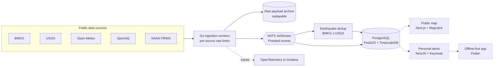
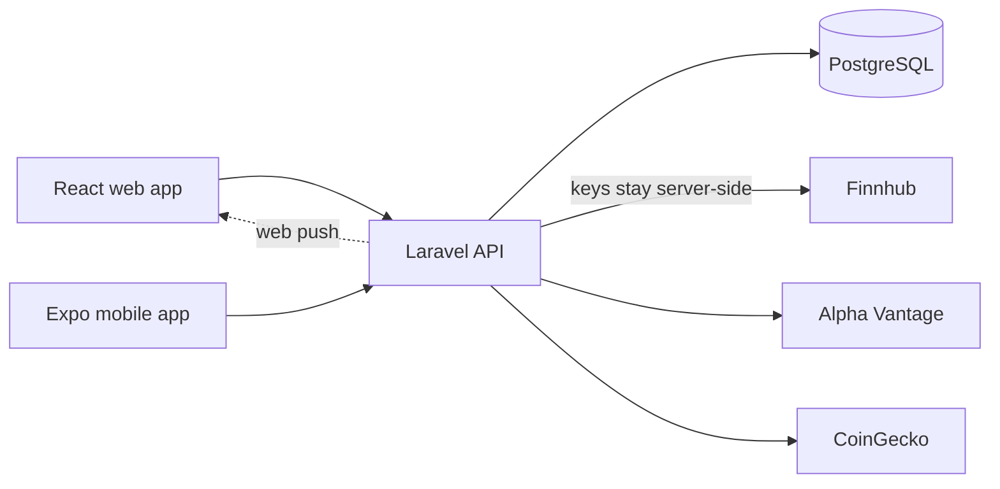
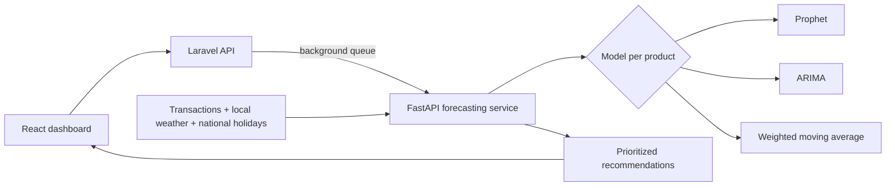
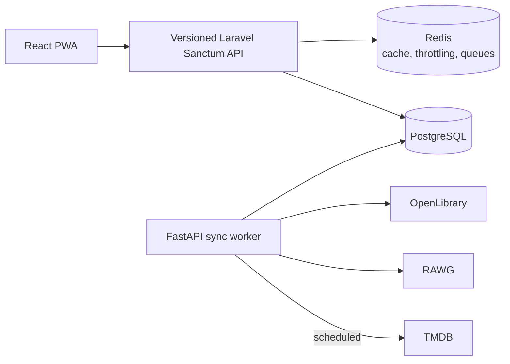
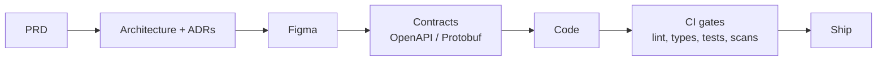

<div align="center">


<a href="https://github.com/ramirezzServer"></a>


<a href="https://linkedin.com/in/faris-yahya-ayyash-alfatih-0a502a215"></a>
<a href="mailto:faris651234@gmail.com"></a>
<br/>


<br/><br/>


</div>

---

## About

```ts
const faris = {
  name:        "Faris Yahya Ayyash Alfatih",
  base:        "Bandung, Indonesia (UTC+7)",
  study:       "Information Systems @ Telkom University",
  roles:       ["Full-Stack Developer", "UI/UX Designer"],
  lab:         ["Lab Assistant @ EISD Laboratory", "Practicum Assistant @ EISD Laboratory"],
  now:         "SIAGA — disaster early warning + air quality for West Java",
  maintaining: ["TradeView Dashboard (web + mobile)"],
  shipped:     ["Spektra", "UMKM-Sense (PKM-KC, team lead)"],
  completed:   ["Bina Desa community development program (R&D division)"],
  openTo:      ["Internships", "Freelance", "Collaboration"],
} as const;
```

I'm Faris, an Information Systems student at Telkom University in Bandung. I build web apps end to end: product documents first, then the API, the interface, and the pipeline that ships it. I also design, so most of my interfaces start in Figma before they turn into React.

Lately I have been spending more time on the backend side of things: event-driven services in Go, geospatial and time-series data in PostgreSQL, and running it all on Kubernetes with proper CI, tracing, and secret management.

On campus I work at **EISD Laboratory** as both a lab assistant and a practicum assistant: helping run practicum sessions, mentoring students, reviewing their work, and supporting the lab day to day. Coursework keeps the rest of my toolbox wide: AWS and Google Cloud for cloud computing, Pentaho and MySQL for data warehousing, Cisco Packet Tracer for networking, Google Colab for data mining and machine learning, and VMware or VirtualBox whenever something needs its own machine.

<table>
  <tr>
    <td><b>Now</b></td>
    <td>Building SIAGA, a disaster early warning and air quality platform for West Java</td>
  </tr>
  <tr>
    <td><b>Lab</b></td>
    <td>Lab Assistant and Practicum Assistant at EISD Laboratory, Telkom University</td>
  </tr>
  <tr>
    <td><b>Maintaining</b></td>
    <td>TradeView Dashboard (web and mobile)</td>
  </tr>
  <tr>
    <td><b>Shipped</b></td>
    <td>Spektra, UMKM-Sense (PKM-KC, team lead)</td>
  </tr>
  <tr>
    <td><b>Completed</b></td>
    <td>Community development work with Bina Desa (R&D division), including Smart Posyandu</td>
  </tr>
  <tr>
    <td><b>Open to</b></td>
    <td>Internships, freelance, and collaboration</td>
  </tr>
</table>

---

## Featured Projects

<table>
  <tr>
    <td width="50%" valign="top">
      <h3><a href="https://github.com/ramirezzServer/siaga">SIAGA</a></h3>
      
      <p>Disaster early warning and air quality monitoring for West Java, with Greater Bandung as the focus area. It pulls BMKG, USGS, Open-Meteo, OpenAQ, and NASA FIRMS data into one event-driven pipeline and matches hazards to places people care about.</p>
      <p>Done so far: ingestion with per-source rate limits, BMKG and USGS earthquake deduplication calibrated on historical catalogs, a raw payload archive that can be replayed, river gauge cells picked from GloFAS reanalysis, OpenTelemetry tracing into Grafana, and signed container images with Kubernetes manifests. Planned next: flood thresholds, the public map, personal alerts, and an offline-first mobile app.</p>
      <p>
        
        
        
        
        
        
        
      </p>
      <sub>Planned for later phases: Next.js, MapLibre, NestJS, Keycloak, Flutter.</sub>
    </td>
    <td width="50%" valign="top">
      <h3><a href="https://github.com/ramirezzServer/tradeview-dashboard">TradeView Dashboard</a></h3>
      
      <p>Trading simulation and portfolio dashboard on web and mobile. Watchlist, portfolio, OHLCV charts, company financials, crypto, market news, and web push notifications.</p>
      <p>One Laravel API serves both the React web app and the Expo mobile app, and proxies Finnhub, Alpha Vantage, and CoinGecko so API keys never leave the server. Feature work is done for now; the repo is in maintenance.</p>
      <p>
        
        
        
        
        
        
        
      </p>
    </td>
  </tr>
  <tr>
    <td width="50%" valign="top">
      <h3><a href="https://github.com/ramirezzServer/UMKM-SENSE">UMKM-Sense</a> <sub>PKM-KC</sub></h3>
      
      <p>AI sales forecasting for Indonesian small businesses, built for PKM-KC where I led the team. It combines transaction history with local weather and national holidays to forecast sales per product and turn the result into prioritized recommendations.</p>
      <p>A separate FastAPI service picks between Prophet, ARIMA, and weighted moving average for each product. Laravel calls it through a background queue, so a slow forecast never blocks the API.</p>
      <p>
        
        
        
        
        
        
      </p>
    </td>
    <td width="50%" valign="top">
      <h3><a href="https://github.com/ramirezzServer/Spektra">Spektra</a></h3>
      
      <p>Media tracker for films, series, games, and books. Personal library with ratings and reviews, public profiles, follows, activity feeds, and custom lists, installable as a PWA.</p>
      <p>React frontend on a versioned Laravel Sanctum API, with a FastAPI worker that syncs content from TMDB, RAWG, and OpenLibrary on a schedule. Redis handles caching, throttling, and queues; the whole stack runs from Docker Compose.</p>
      <p>
        
        
        
        
        
        
        
      </p>
    </td>
  </tr>
</table>

<div align="center">
  <a href="https://github.com/ramirezzServer/siaga"></a>
  <a href="https://github.com/ramirezzServer/tradeview-dashboard"></a>
  <a href="https://github.com/ramirezzServer/UMKM-SENSE"></a>
  <a href="https://github.com/ramirezzServer/Spektra"></a>
</div>

### Architecture at a glance

<details>
<summary><b>SIAGA</b> — event-driven ingestion pipeline (dashed = planned)</summary>
<br/>



</details>

<details>
<summary><b>TradeView Dashboard</b> — one API, two clients</summary>
<br/>



</details>

<details>
<summary><b>UMKM-Sense</b> — forecasting off the request path</summary>
<br/>



</details>

<details>
<summary><b>Spektra</b> — API, cache, and scheduled sync worker</summary>
<br/>



</details>

### Other work

| Project | What it is | Stack |
| --- | --- | --- |
| OurTucTuc Mobility System | Laravel and Blade app for a small transport service | Laravel, Blade |
| Sirkula | Group project, in progress: community marketplace for second-hand goods and recycling between city and village communities (SDG 12) | Laravel, Laravel Cloud |
| TelEvent | Campus event system built as GraphQL microservices | Node.js, GraphQL, Docker, MySQL on Railway |
| NRG Data Warehouse | Data warehouse for a retail case study (Nusantara Retail Group) | Pentaho Data Integration, MySQL |
| Smart Posyandu | Community health post management system, built during Bina Desa | Laravel, MySQL, React, TypeScript, Docker, Nginx, VPS |
| BimbingKita | Thesis supervision web app, UX design proposal for GEMASTIK XIX | Figma |
| Cloud Computing | Group cloud project on a shared AWS account with IAM users per member | AWS |
| Coursework labs | Naive Bayes sleep disorder classifier, K-Means and logistic regression on UMKM data, load and stress testing, E2E test automation, SQL injection mitigation with ModSecurity | Streamlit, Google Colab, scikit-learn, JMeter, Katalon Studio, VirtualBox, Ubuntu |

---

## Tech Stack

<details open>
<summary><b>Languages</b></summary>
<p align="center">
  
  <br/>
  
</p>
</details>

<details open>
<summary><b>Frontend and Mobile</b></summary>
<p align="center">
  
  <br/>
  
  
  
  
  
  
  
</p>
</details>

<details open>
<summary><b>Backend and APIs</b></summary>
<p align="center">
  
  <br/>
  
  
  
  
  
</p>
</details>

<details open>
<summary><b>Data, Analytics and ML</b></summary>
<p align="center">
  
  <br/>
  
  
  
  
  
  
  
  
  
  
</p>
</details>

<details open>
<summary><b>Cloud and Hosting</b></summary>
<p align="center">
  
  <br/>
  
  
  
  
  
  
  
  
  
</p>
</details>

<details open>
<summary><b>Infrastructure, DevOps and Observability</b></summary>
<p align="center">
  
  <br/>
  
  
  
  
  
  
</p>
</details>

<details open>
<summary><b>Virtualization and Networking</b></summary>
<p align="center">
  
  
  
  
</p>
</details>

<details open>
<summary><b>Testing, QA and Security</b></summary>
<p align="center">
  
  <br/>
  
  
  
</p>
</details>

<details open>
<summary><b>Tooling</b></summary>
<p align="center">
  
  <br/>
  
</p>
</details>

<details open>
<summary><b>Design</b></summary>
<p align="center">
  
  <br/>
  
  
</p>
</details>

<details>
<summary><b>Next up</b> (planned for SIAGA's later phases)</summary>
<p align="center">
  
  <br/>
  
  
</p>
</details>

---

## How I Work

- Write the PRD and architecture doc before the first line of code, and record every non-obvious decision as an ADR.
- Keep contracts explicit: Protobuf for events, OpenAPI for HTTP, generated clients instead of hand-written ones.
- Nothing merges unless CI is green: lint, strict types, tests with coverage gates, image scans, and a secret scanner.
- Prefer boring, free infrastructure that I can rebuild from the repo in one command.
- Design in Figma first, then make sure the design survives contact with real data.



---

## GitHub Stats

<div align="center">      <picture> <source media="(prefers-color-scheme: dark)" srcset="https://raw.githubusercontent.com/ramirezzServer/ramirezzServer/output/github-contribution-grid-snake-dark.svg" /> <source media="(prefers-color-scheme: light)" srcset="https://raw.githubusercontent.com/ramirezzServer/ramirezzServer/output/github-contribution-grid-snake.svg" />  </picture> </div>

---

<div align="center">

<a href="https://linkedin.com/in/faris-yahya-ayyash-alfatih-0a502a215"></a>
<a href="https://instagram.com/rissziee"></a>
<a href="mailto:faris651234@gmail.com"></a>

<br/><br/>

<i>"You can make the same mistake twice, because the second time is not a mistake, it's a choice."</i>


</div>
